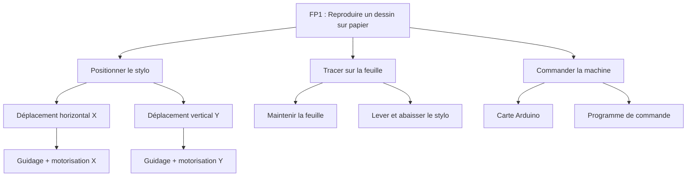

# Études et choix techniques

## 1. Recherche de l'existant

### 1.1 Objectif de la recherche

Avant de commencer la conception, nous avons étudié différentes architectures de machines à dessiner.

Cette recherche permet de comprendre les solutions existantes et de comparer leurs avantages, leurs inconvénients ainsi que leurs contraintes mécaniques et électroniques.

### 1.2 Comparaison des architectures

| Architecture | Principe de fonctionnement | Caractéristiques techniques | Avantages | Inconvénients |
|---|---|---|---|---|
| Cartésienne XY | Le stylo se déplace sur deux axes perpendiculaires X et Y. | Deux axes de guidage, moteurs et système de transmission. | Programmation relativement simple, bonne précision possible, adaptée au papier A4. | Nécessite un guidage précis et une structure rigide. |
| CoreXY | Deux moteurs entraînent un ensemble de courroies pour déplacer le stylo. | Moteurs fixes, courroies, poulies et guidages. | Faible masse mobile, déplacements rapides possibles. | Montage et tension des courroies plus complexes. |
| Polargraph | Deux moteurs déplacent un stylo suspendu à des fils. | Fils, bobines, moteurs fixes et calcul des longueurs. | Peu de guidages mécaniques, grande surface possible. | Précision variable et tension des fils à contrôler. |
| SCARA | Deux bras articulés positionnent le stylo. | Articulations motorisées et calcul des angles. | Structure compacte, pas de rails linéaires obligatoires. | Cinématique inverse et réglages mécaniques plus complexes. |
| Table tournante | La feuille tourne pendant que le stylo se déplace radialement. | Plateau motorisé et axe radial. | Adaptée aux dessins circulaires, structure compacte. | Moins pratique pour certains dessins rectangulaires. |
| Machine à quatre câbles | Quatre câbles motorisés positionnent le porte-stylo. | Quatre actionneurs, câbles et contrôle des tensions. | Grande surface de dessin possible. | Synchronisation et maintien de tension complexes. |

### 1.3 Exemple de machine existante : AxiDraw

La machine AxiDraw constitue une référence intéressante pour notre projet.

Elle utilise un système de déplacement XY permettant de reproduire des dessins sur différents supports, notamment sur du papier A4.

Son fonctionnement repose sur un guidage mécanique, des moteurs et un système permettant de lever le stylo.

Nous retenons principalement :
- L'utilisation d'une architecture XY.
- L'importance de la rigidité du guidage.
- La nécessité d'un système de levage du stylo.
- L'intérêt de séparer les déplacements horizontaux et verticaux dans la programmation.

Source :
https://www.axidraw.com/

### 1.4 Conclusion de la recherche

Après comparaison des différentes architectures, notre groupe a choisi de s'orienter vers une architecture cartésienne XY.

Ce choix s'explique par la simplicité relative de son principe de fonctionnement, la possibilité de réaliser des dessins précis et la disponibilité de rails ou de glissières au Makerspace.

Cette architecture nous semble adaptée à notre objectif de reproduction de dessins sur une feuille A4.

Le choix du système de motorisation et de transmission reste cependant à confirmer.

---

## 2. Pré-étude de faisabilité

### 2.1 Objectif

Cette pré-étude vise à identifier les principales difficultés techniques avant la fabrication de la machine.

Nous souhaitons vérifier que les composants disponibles peuvent répondre aux besoins du projet et anticiper les problèmes mécaniques ou électroniques.

À ce stade, l'inventaire a commencé, mais aucun résultat de test de faisabilité n'est encore disponible.

### 2.2 Difficultés techniques envisagées

| Point technique | Difficulté possible | Vérification ou solution envisagée | État |
|---|---|---|---|
| Motorisation | Les servomoteurs disponibles peuvent avoir une course limitée. | Identifier leur référence, leur angle de rotation et leur couple. | À vérifier |
| Déplacement X | Risque de frottement ou de jeu mécanique. | Tester un chariot sur le rail horizontal. | Test prévu |
| Déplacement Y | Risque de mauvais alignement. | Vérifier le parallélisme et la fluidité du guidage. | Test prévu |
| Transmission | Risque de glissement ou de jeu. | Comparer courroie, vis et autres transmissions disponibles. | À étudier |
| Levage du stylo | Pression excessive ou stylo restant en contact avec la feuille. | Concevoir un petit mécanisme de levage. | Test prévu |
| Commande électronique | Alimentation ou signaux incompatibles. | Vérifier les caractéristiques des moteurs et de l'Arduino. | À vérifier |
| Précision | Écarts entre les dimensions programmées et tracées. | Mesurer un carré test et comparer les dimensions. | Test prévu |
| Format A4 | Course insuffisante sur un axe. | Mesurer les courses utiles des rails. | À vérifier |

### 2.3 Étude particulière des servomoteurs

Le Makerspace dispose de servomoteurs, mais leur référence exacte reste à identifier.

Il existe plusieurs types de servomoteurs :

- Les servomoteurs classiques, qui permettent de contrôler une position angulaire sur une course limitée.
- Les servomoteurs à rotation continue, qui permettent de contrôler le sens et la vitesse de rotation, mais pas directement une position absolue.

Pour une machine XY, nous devons pouvoir contrôler précisément la position du stylo.

Nous devons donc vérifier si les servomoteurs disponibles sont adaptés à la transmission envisagée.

Si ce n'est pas le cas, nous étudierons une autre solution, par exemple des moteurs pas à pas pour les axes X et Y, tout en conservant éventuellement un servomoteur pour le levage du stylo.

### 2.4 Protocole de tests envisagé

**Test 1 : identification des moteurs**

Relever les références, les tensions d'alimentation, les caractéristiques de rotation et les dimensions des moteurs.

**Test 2 : déplacement sur un rail**

Installer provisoirement un chariot sur un rail et vérifier que son déplacement est fluide, sans blocage.

**Test 3 : commande électronique**

Brancher un moteur à une carte de commande adaptée et vérifier qu'il réagit correctement aux instructions.

**Test 4 : précision du déplacement**

Demander plusieurs déplacements identiques et mesurer les écarts observés.

**Test 5 : dessin simple**

Réaliser un carré et vérifier ses dimensions ainsi que la qualité des tracés.

### 2.5 Résultats actuels

Aucun test expérimental n'a encore été réalisé ou documenté dans cette pré-étude.

La prochaine étape consiste à terminer l'inventaire du matériel, puis à réaliser les premiers essais de motorisation et de guidage.

---

## 3. Diagramme FAST

Le diagramme FAST permet de relier la fonction principale de notre machine aux fonctions techniques nécessaires pour la réaliser.

Les solutions représentées correspondent à notre architecture envisagée. Les moteurs et les transmissions exacts restent à valider.

---

## 4. Choix techniques

### 4.1 Choix de l'architecture

**Contexte :**

Nous devons concevoir une machine capable de reproduire automatiquement des dessins sur une feuille A4. Le mécanisme doit permettre de contrôler précisément les déplacements du stylo.

**Options envisagées :**

Nous avons étudié plusieurs architectures : cartésienne XY, CoreXY, Polargraph, SCARA, table tournante et machine à câbles.

**Choix retenu et pourquoi :**

Nous avons retenu l'architecture cartésienne XY.

Elle permet de décomposer les mouvements en deux déplacements perpendiculaires. Son fonctionnement est relativement simple à comprendre et à programmer.

De plus, le Makerspace dispose de rails ou de glissières, ce qui facilite l'étude d'un système de guidage.

**Compromis acceptés :**

Cette architecture nécessite une structure mécanique suffisamment rigide, un bon alignement des axes et un système de transmission adapté.

Nous acceptons une conception potentiellement plus encombrante en échange d'un mécanisme plus simple à étudier.

### 4.2 Choix du format de dessin

**Contexte :**

Nous souhaitons réaliser une machine adaptée à un usage de démonstration et capable de produire des dessins sur papier.

**Options envisagées :**

Plusieurs formats sont possibles, notamment A5, A4 et A3.

**Choix retenu et pourquoi :**

Nous avons retenu le format A4, de dimensions 210 × 297 mm.

Ce format est courant et permet de réaliser des dessins suffisamment grands tout en conservant une machine relativement compacte.

**Compromis acceptés :**

La structure et les déplacements devront être dimensionnés pour couvrir la zone de dessin prévue.

Nous ne cherchons pas, pour le moment, à réaliser des dessins au format A3.

### 4.3 Choix du guidage

**Contexte :**

Le stylo doit se déplacer de manière régulière sur les axes X et Y.

**Options envisagées :**

Nous pouvons envisager des rails linéaires, des glissières ou d'autres systèmes de guidage mécanique.

**Choix retenu et pourquoi :**

Nous souhaitons privilégier les rails ou glissières déjà disponibles au Makerspace.

Cette solution évite de fabriquer entièrement les éléments de guidage.

**Compromis acceptés :**

Les dimensions et les caractéristiques des rails disponibles peuvent imposer certaines contraintes sur la structure.

Nous devrons également vérifier leur état, leur course utile et leur rigidité.

### 4.4 Choix de la motorisation

**Contexte :**

Les moteurs doivent permettre de déplacer le stylo de manière contrôlée et reproductible.

**Options envisagées :**

- Servomoteurs classiques.
- Servomoteurs à rotation continue.
- Moteurs pas à pas.

**Choix retenu et pourquoi :**

Le choix définitif n'est pas encore arrêté.

Nous souhaitons d'abord étudier les servomoteurs disponibles au Makerspace.

Leur utilisation dépendra de leurs caractéristiques et du système de transmission choisi.

**Compromis acceptés :**

Nous devrons éventuellement utiliser d'autres moteurs si les servomoteurs disponibles ne permettent pas un contrôle suffisamment précis de la position.

### 4.5 Choix de la carte électronique

**Contexte :**

La machine nécessite une carte capable de commander les moteurs et de coordonner les déplacements.

**Options envisagées :**

Arduino, ESP32 ou autres cartes de commande compatibles.

**Choix retenu et pourquoi :**

Nous envisageons d'utiliser une carte Arduino.

Cette carte est adaptée à la réalisation de prototypes électroniques et permet de programmer les mouvements des moteurs avec des bibliothèques existantes.

**Compromis acceptés :**

La carte devra être associée à une alimentation et, si nécessaire, à des circuits de commande adaptés aux moteurs.

Le modèle exact d'Arduino reste à confirmer.

### 4.6 Choix du système de levage du stylo

**Contexte :**

Pour reproduire des dessins composés de plusieurs traits séparés, le stylo doit pouvoir être levé puis abaissé.

**Options envisagées :**

- Petit servomoteur.
- Mécanisme à ressort.
- Autre système mécanique de levage.

**Choix retenu et pourquoi :**

Nous envisageons un petit servomoteur associé à un porte-stylo mobile.

Cette solution pourrait permettre de commander facilement deux positions : stylo levé et stylo abaissé.

**Compromis acceptés :**

Ce mécanisme ajoute un composant et nécessite un réglage de la hauteur du stylo.

Le choix sera confirmé après les premiers tests.

---

## 5. État d'avancement du projet

| Travail | État |
|---|---|
| Comparaison des architectures | Réalisée |
| Choix de l'architecture XY | Confirmé |
| Choix du format A4 | Confirmé |
| Inventaire du matériel | En cours |
| Identification des servomoteurs | À faire |
| Vérification des rails | À faire |
| Conception mécanique | À commencer |
| Tests électroniques | Non réalisés |
| Assemblage | Non commencé |
| Premiers dessins | Non réalisés |

### Prochaines étapes

Nous devons terminer l'inventaire du matériel disponible au Makerspace.

La priorité est d'identifier les références des servomoteurs et de mesurer les rails ou glissières.

Nous pourrons ensuite définir le système de transmission, réaliser un premier schéma mécanique et commencer les tests.

---

## 6. Sources documentaires

### AxiDraw

Site officiel :
https://www.axidraw.com/

Documentation d'une machine à dessiner XY utilisant des moteurs, un système de guidage et un mécanisme de levage du stylo.

### CoreXY

Documentation Marlin :
https://marlinfw.org/docs/printers/corexy.html

Présentation du fonctionnement des mécanismes CoreXY et de la coordination des moteurs.

### Bibliothèque Arduino Servo

Documentation :
https://github.com/arduino-libraries/Servo

Informations sur la commande des servomoteurs classiques et à rotation continue.

### Documentation technique complémentaire

Les références exactes des moteurs, des rails et des autres composants utilisés seront ajoutées après la fin de l'inventaire du Makerspace.
